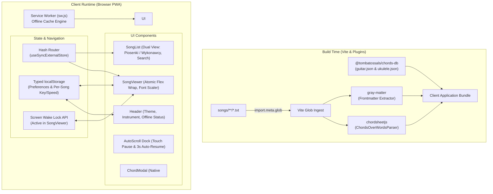
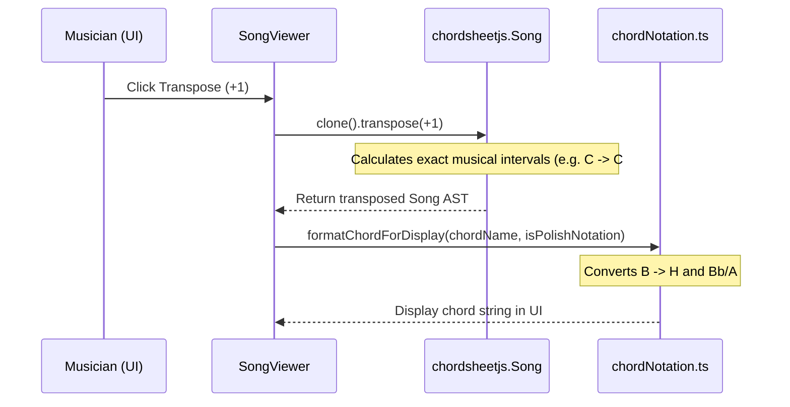
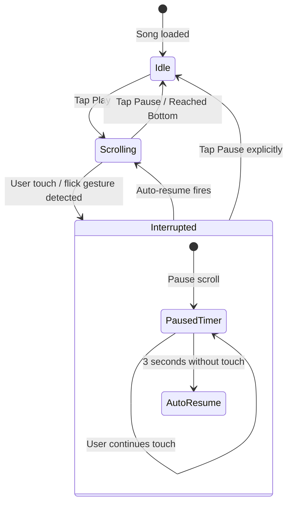

# Technical Implementation Plan: Offline Songbook PWA

This technical plan details the architecture, external dependencies, system workflows, and phased execution roadmap for the Mobile Offline Songbook PWA.

---

## 1. Architecture & System Design

### 1.1. High-Level System Architecture



### 1.2. Zero-Dependency Hash Routing Architecture
Navigation relies on browser hash routing (`#/`, `#/song/:slug`, `#/artist/:slug`) without third-party router libraries:
- Implemented with React 19's native `useSyncExternalStore`:
  ```ts
  export function useHashRoute(): string {
    return useSyncExternalStore(
      (notify) => {
        window.addEventListener('hashchange', notify);
        return () => window.removeEventListener('hashchange', notify);
      },
      () => window.location.hash || '#/'
    );
  }
  ```
- Guarantees instant client-side route changes on GitHub Pages without 404 rewriting or server configuration.

### 1.3. Persistence Schema (`localStorage`)
```ts
interface LocalStorageSchema {
  // Global settings
  'spiewnik_theme': 'dark' | 'light';
  'spiewnik_instrument': 'guitar' | 'ukulele';
  'spiewnik_polish_notation': boolean;
  'spiewnik_font_offset': number; // -4 to +12 px
  'spiewnik_favorites': string[]; // Array of song slugs

  // Per-song settings (keyed by slug)
  'spiewnik_song_pref_<slug>': {
    transpose: number;    // Semitone shift (+/- N)
    scrollSpeed: number;  // Pixels per second (15-120)
  };
}
```

---

## 2. Dependencies & External Tools Strategy

To minimize hand-rolled logic, the system delegates heavy technical tasks to battle-tested libraries:

| Dependency | Category | Role in Architecture | Hand-Rolled Code Replaced |
|---|---|---|---|
| **`chordsheetjs`** | Parsing & Transposition | Parses `songs/*.txt` into structured `Song` AST; executes musical interval math via `song.transpose(semitones)`. | Replaces ~150 lines of custom chromatic circle and interval transposition logic. |
| **`@tombatossals/chords-db`** | Data Source | Provides verified fretboard positions, fingerings, and barres for Guitar (6 strings) and Ukulele (4 strings). | Eliminates manual chord database curation and voicing lookups. |
| **`gray-matter`** | Metadata Parsing | Extracts YAML frontmatter (`title`, `artist`, `key`, `tags`) from raw song text files. | Replaces error-prone regex header extraction. |
| **`lucide-react`** | UI Icons | Standardized lightweight SVG icons for transport, instruments, and settings. | Zero custom icon maintenance. |
| **`@tailwindcss/vite`** | Styling Engine | Zero-config Tailwind CSS v4 pipeline configured directly in Vite. | Eliminates PostCSS and Tailwind configuration files. |
| **`vite-plugin-pwa`** | PWA & Offline | Generates service worker, precaches static assets and song bundles, configures auto-update lifecycle. | Replaces manual service worker caching scripts. |

---

## 3. Technical Workflows & State Machines

### 3.1. Song Ingestion & Build-Time Globbing Pipeline
```
[songs/**/*.txt]
      │
      ▼  Vite eager glob (query: '?raw')
[Raw String Map: { path: rawText }]
      │
      ▼  gray-matter(rawText)
[Frontmatter Data + Content Text]
      │
      ▼  chordsheetjs.ChordsOverWordsParser.parse(content)
[ParsedSong Object]
      │
      ▼
[Memory Catalog Array in Client Bundle]
```

### 3.2. Transposition & Polish Notation Formatting Pipeline


### 3.3. Strict Chord Lookup & SVG Rendering Workflow
1. User taps chord chip (e.g. `F#m`) in top bar or inline in lyrics.
2. `chordDb.ts` maps chord string to key & suffix:
   - Guitar: `F#m` -> Key `Fsharp`, Suffix `minor`.
   - Ukulele: `F#m` -> Key `Gb`, Suffix `minor`.
3. Check chords database entry:
   - **Found**: Pass positions array into `<ChordModal />`. Render SVG fretboard diagram with variation carousel (`◀ Position 1 of N ▶`).
   - **Not Found (slash/uncataloged)**: Return `null`. Display fallback message: *"Diagram niedostępny dla tego chwytu"*.

### 3.4. Auto-Scroll Engine & Touch Interruption State Machine


### 3.5. Screen Wake Lock Lifecycle
- **Mount `SongViewer`**:
  ```ts
  if ('wakeLock' in navigator) {
    wakeLockSentinel = await navigator.wakeLock.request('screen');
  }
  ```
- **Visibility Change**: When browser tab regains focus, automatically re-acquire lock.
- **Unmount `SongViewer`**: Release sentinel cleanly.

### 3.6. PWA Precaching & Background Update Workflow
1. App initializes `virtual:pwa-register`.
2. Service Worker registers and caches all assets defined in `dist/`.
3. If a new deployment is pushed to GitHub Pages, the Service Worker installs in the background.
4. When installation finishes, trigger `onNeedRefresh`:
   - Display non-intrusive toast: *"Nowe piosenki pobrane"* with *"Odśwież"* button.
   - User clicks *"Odśwież"* -> Service worker skips waiting and updates client.

### 3.7. GitHub Pages CI/CD Workflow (`.github/workflows/deploy.yml`)
1. Trigger: Push to branch `master`.
2. Job:
   - Checkout repository.
   - Setup Node.js 22.
   - Run `npm ci` and `npm run build`.
   - Upload `dist/` directory via `actions/upload-pages-artifact`.
   - Deploy to GitHub Pages via `actions/deploy-pages`.

---

## 4. Directory Structure & Module Boundaries

```
spiewnik/
├── .github/
│   └── workflows/
│       └── deploy.yml              # CI/CD automated build and deploy to GitHub Pages
├── docs/
│   ├── PRD.md                      # Product Requirements Document
│   └── PLAN.md                     # This implementation plan
├── songs/                          # Song files (flat or grouped by author)
│   ├── lornetka.txt
│   ├── wehikul-czasu.txt
│   ├── whisky.txt
│   └── bieszczadzkie-anioly.txt
├── src/
│   ├── components/
│   │   ├── AutoScroll.tsx          # Floating dock + 3s touch pause + jump to top
│   │   ├── ChordModal.tsx          # Native HTML5 <dialog> with ChordSvg variation carousel
│   │   ├── ChordSvg.tsx            # SVG vector fretboard renderer (guitar 6-str / uke 4-str)
│   │   ├── Header.tsx              # Nav bar, instrument toggle, theme toggle, offline badge
│   │   ├── SongList.tsx            # Dual view (Piosenki / Wykonawcy), search, tag chips, favorites
│   │   ├── SongViewer.tsx          # Atomic chord-syllable flex wrap, transposer, font scaler
│   │   └── Toast.tsx               # Subtle PWA update toast
│   ├── hooks/
│   │   ├── useHashRoute.ts         # Native 3-line useSyncExternalStore hash router
│   │   ├── useWakeLock.ts          # Screen Wake Lock API lifecycle hook
│   │   └── useLocalStorage.ts     # Typed storage hook for preferences & per-song state
│   ├── lib/
│   │   ├── chordDb.ts              # Strict lookup against chords-db guitar/ukulele JSON
│   │   ├── chordNotation.ts        # Display mapping: Polish (H/B) vs International (B/Bb)
│   │   └── songParser.ts           # gray-matter + chordsheetjs loader
│   ├── types/
│   │   └── index.ts                # TypeScript interfaces (Song, Instrument, Preferences)
│   ├── App.tsx                     # Top layout + hash routing switch
│   ├── main.tsx                    # React root + PWA service worker registration
│   └── index.css                   # Tailwind v4 import
├── index.html                      # Mobile shell (theme-color, viewport-fit=cover)
├── package.json                    # Dependencies & build scripts
├── tsconfig.json                   # Strict TypeScript compiler options
└── vite.config.ts                  # Vite + Tailwind + VitePWA precaching config
```

---

## 5. Phased Implementation Roadmap

### Phase 1: Project Scaffolding & Setup *(Status: Completed)*
- [x] Initialized Vite 6 + React 19 + TypeScript + Tailwind CSS v4.
- [x] Installed and validated dependencies (`chordsheetjs`, `@tombatossals/chords-db`, `gray-matter`, `lucide-react`, `vite-plugin-pwa`).
- [x] Configured PWA manifest, viewport meta tags, and mobile shell.
- [x] Seeded starter songs in `songs/`.
- [x] Verified build output: `npm.cmd run build` succeeds with 0 errors.

### Phase 2: Content Pipeline & Parsing Engine
- [ ] Implement `src/lib/songParser.ts` leveraging `gray-matter` and `chordsheetjs.ChordsOverWordsParser`.
- [ ] Implement `src/lib/chordNotation.ts` for Polish `H` / `B` display transformation and sharp accidental defaults.
- [ ] Unit test parser against all starter songs to verify chord/lyric token alignment.

### Phase 3: Chord Database & Modal Component
- [ ] Implement `src/lib/chordDb.ts` querying `@tombatossals/chords-db` for guitar and ukulele chord voicings.
- [ ] Implement `src/components/ChordModal.tsx` using native HTML5 `<dialog>` and `ChordSvg.tsx`.
- [ ] Add variation carousel (`◀ 1 z N ▶`) and instrument switcher inside the modal.

### Phase 4: Song Viewer, Transposition & Auto-Scroll
- [ ] Implement `src/hooks/useWakeLock.ts` to manage screen lock during song viewing.
- [ ] Implement `src/components/AutoScroll.tsx` with floating bottom dock, speed controls, and 3-second touch pause auto-resume.
- [ ] Implement `src/components/SongViewer.tsx`:
  - Top quick-reference chord chips bar.
  - Atomic chord-syllable flex wrapping columns.
  - Transposition controls with built-in `song.transpose()` and reset button.
  - Font scaling buttons (`A-` / `A+`).
  - Top back button (←) to catalog.

### Phase 5: Catalog, Wykonawcy View & Search
- [ ] Implement `src/hooks/useHashRoute.ts` with `useSyncExternalStore`.
- [ ] Implement `src/hooks/useLocalStorage.ts` for per-song persistence and global preferences.
- [ ] Implement `src/components/Header.tsx` (Instrument switch, theme toggle, offline status).
- [ ] Implement `src/components/SongList.tsx`:
  - Tab 1: **Piosenki** (instant search across title, artist, tags, lyrics with snippet preview).
  - Tab 2: **Wykonawcy** (alphabetical artist listing with song count, drilldown to songs).
  - Tab 3: **Ulubione** (starred songs filter).
  - Tag filter chips bar.

### Phase 6: PWA Registration, Polish UI & CI/CD
- [ ] Implement `src/components/Toast.tsx` for PWA update alerts.
- [ ] Register Service Worker update callbacks in `src/main.tsx`.
- [ ] Create `.github/workflows/deploy.yml` for automated GitHub Pages deployment.
- [ ] Final verification: offline test in DevTools, mobile responsiveness, chord accuracy.

---

## 6. Verification & Automated Testing Plan

### Automated Checks
```powershell
# Type checking and production bundle build
npm.cmd run build

# Verify PWA service worker and precache generation
Test-Path dist/sw.js
Test-Path dist/manifest.webmanifest
```

### Manual Verification Matrix
1. **Catalog & Navigation**:
   - Verify switching between **Piosenki**, **Wykonawcy**, and **Ulubione** tabs.
   - Verify typing in search box filters by title, artist, tag, and lyric text.
   - Verify deep linking: navigating to `#/song/lornetka` directly opens the song viewer.
2. **Song Layout & Chords**:
   - Verify atomic wrapping: on mobile viewport (375px), long lines wrap at word boundaries without chords detaching from syllables.
   - Verify tapping chord chips (in top bar or inline) opens `ChordModal`.
   - Verify variation carousel navigates alternative fingerings.
3. **Transposition & Notation**:
   - Transpose song up/down; verify chords shift by semitone using sharp accidentals (`#`).
   - Toggle Polish notation; verify `B` natural transforms to `H`.
4. **Auto-Scroll & Wake Lock**:
   - Start auto-scroll; flick screen and verify scroll pauses for 3 seconds, then automatically resumes.
   - Verify screen does not dim or sleep while `SongViewer` is mounted.
5. **Offline Reliability**:
   - Set DevTools `Network: Offline`. Refresh page. Verify full catalog, song viewer, and chord diagrams work without network access.
