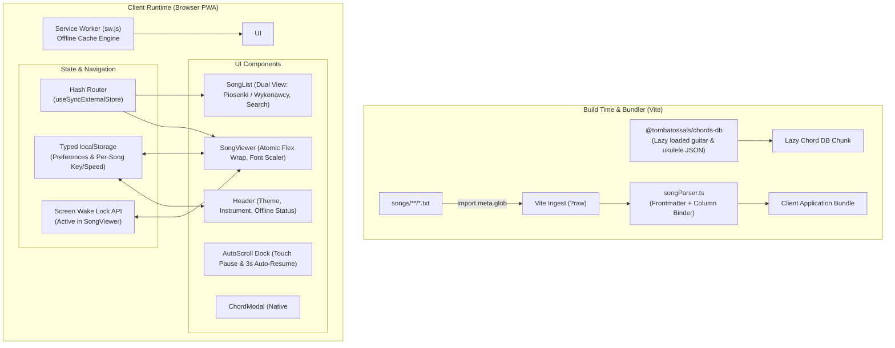
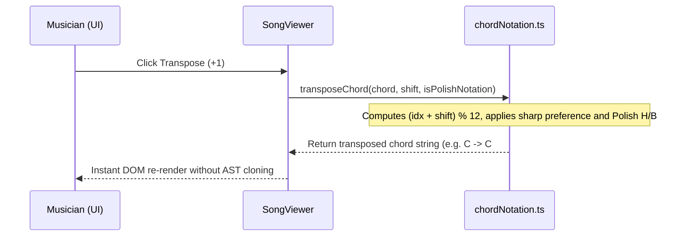
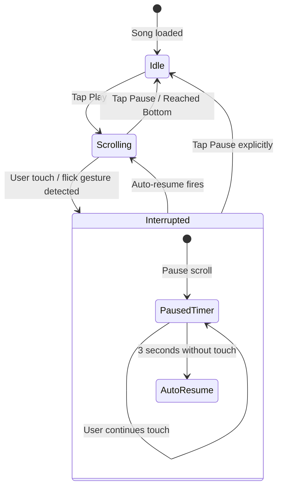

# Technical Implementation Plan: Offline Songbook PWA

This technical plan details the architecture, external dependencies, system workflows, and phased execution roadmap for the Mobile Offline Songbook PWA.

---

## 1. Architecture & System Design

### 1.1. High-Level System Architecture



### 1.2. Zero-Dependency Hash Routing Architecture
Navigation relies on browser hash routing (`#/`, `#/song/:slug`, `#/artist/:slug`) without third-party router libraries:
- Implemented with React 19's native `useSyncExternalStore`:
  ```ts
  export function useHashRoute(): string {
    return useSyncExternalStore(
      (notify) => {
        window.addEventListener('hashchange', notify);
        return () => window.removeEventListener('hashchange', notify);
      },
      () => window.location.hash || '#/'
    );
  }
  ```
- Guarantees instant client-side route changes on GitHub Pages without 404 rewriting or server configuration.

### 1.3. Persistence Schema (`localStorage`)
```ts
interface LocalStorageSchema {
  // Global settings
  'spiewnik_theme': 'dark' | 'light';
  'spiewnik_instrument': 'guitar' | 'ukulele';
  'spiewnik_polish_notation': boolean;
  'spiewnik_font_offset': number; // -4 to +12 px
  'spiewnik_favorites': string[]; // Array of song slugs

  // Per-song settings (keyed by slug)
  'spiewnik_song_pref_<slug>': {
    transpose: number;    // Semitone shift (+/- N)
    scrollSpeed: number;  // Pixels per second (15-120)
  };
}
```

---

## 2. Dependencies & Zero-Debt Tools Strategy

The architecture follows a strict minimal-tooling policy: native Web Platform APIs and concise TypeScript functions replace heavy external libraries, reducing `node_modules` by >60 MB and bundle size by >300 KB:

| Dependency | Category | Role in Architecture | Hand-Rolled Code Replaced / Rationale |
|---|---|---|---|
| **`react` & `react-dom`** | Core UI | High-performance declarative component rendering (React 19). | Core framework. |
| **`@tombatossals/chords-db`** | Data Source | Provides verified fretboard positions, fingerings, and barres for Guitar (6 strings) and Ukulele (4 strings). | Lazy-loaded dynamically on modal trigger; eliminates manual voicing curation. |
| **`@tailwindcss/vite`** | Styling Engine | Zero-config Tailwind CSS v4 pipeline configured directly in Vite. | Eliminates PostCSS and Tailwind configuration files. |
| **`vite-plugin-pwa`** | PWA & Offline | Generates service worker, precaches static assets and song bundles, configures auto-update lifecycle. | Replaces manual service worker caching scripts. |
| *(Replaced)* `chordsheetjs` | Native Parser | Replaced by `songParser.ts` (~80 lines) and `chordNotation.ts` (~60 lines). | Direct column-by-column chord/lyric binding for atomic flex wrapping; exact sharp accidental preference and Polish `H`/`B` notation. |
| *(Replaced)* `gray-matter` | Native Parser | Replaced by `parseFrontmatter` in `songParser.ts` (~15 lines). | Eliminates Node.js `Buffer` and `js-yaml` dependencies from the client bundle. |
| *(Replaced)* `lucide-react` | Native SVGs | Replaced by `Icons.tsx` (~60 lines). | Eliminates 36.8 MB package on disk for ~8 standard UI icons. |
| *(Replaced)* `react-chords` | Native SVG | Replaced by `ChordSvg.tsx` (256 lines). | Custom React 19 SVG fretboard renderer with dark-theme styling. |

---

## 3. Technical Workflows & State Machines

### 3.1. Song Ingestion & Build-Time Globbing Pipeline
```
[songs/**/*.txt]
      │
      ▼  Vite eager glob (query: '?raw')
[Raw String Map: { path: rawText }]
      │
      ▼  parseFrontmatter(rawText) [title, artist, key, tags]
      │
      ▼  bindChordsAndLyrics(chordLine, lyricLine)
[ParsedSong: lines with ChordSegments bound for flex wrapping]
      │
      ▼
[Memory Catalog Array in Client Bundle]
```

### 3.2. Transposition & Polish Notation Formatting Pipeline


### 3.3. Strict Chord Lookup & SVG Rendering Workflow
1. User taps chord chip (e.g. `F#m`) in top bar or inline in lyrics.
2. `chordDb.ts` maps chord string to key & suffix:
   - Guitar: `F#m` -> Key `Fsharp`, Suffix `minor`.
   - Ukulele: `F#m` -> Key `Gb`, Suffix `minor`.
3. Check chords database entry:
   - **Found**: Pass positions array into `<ChordModal />`. Render SVG fretboard diagram with variation carousel (`◀ Position 1 of N ▶`).
   - **Not Found (slash/uncataloged)**: Return `null`. Display fallback message: *"Diagram niedostępny dla tego chwytu"*.

### 3.4. Auto-Scroll Engine & Touch Interruption State Machine


### 3.5. Screen Wake Lock Lifecycle
- **Mount `SongViewer`**:
  ```ts
  if ('wakeLock' in navigator) {
    wakeLockSentinel = await navigator.wakeLock.request('screen');
  }
  ```
- **Visibility Change**: When browser tab regains focus, automatically re-acquire lock.
- **Unmount `SongViewer`**: Release sentinel cleanly.

### 3.6. PWA Precaching & Background Update Workflow
1. App initializes `virtual:pwa-register`.
2. Service Worker registers and caches all assets defined in `dist/`.
3. If a new deployment is pushed to GitHub Pages, the Service Worker installs in the background.
4. When installation finishes, trigger `onNeedRefresh`:
   - Display non-intrusive toast: *"Nowe piosenki pobrane"* with *"Odśwież"* button.
   - User clicks *"Odśwież"* -> Service worker skips waiting and updates client.

### 3.7. GitHub Pages CI/CD Workflow (`.github/workflows/deploy.yml`)
1. Trigger: Push to branch `master`.
2. Job:
   - Checkout repository.
   - Setup Node.js 22.
   - Run `npm ci` and `npm run build`.
   - Upload `dist/` directory via `actions/upload-pages-artifact`.
   - Deploy to GitHub Pages via `actions/deploy-pages`.

---

## 4. Directory Structure & Module Boundaries

```
spiewnik/
├── .github/
│   └── workflows/
│       └── deploy.yml              # CI/CD automated build and deploy to GitHub Pages
├── docs/
│   ├── PRD.md                      # Product Requirements Document
│   └── PLAN.md                     # This implementation plan
├── songs/                          # Song files (flat or grouped by author)
│   ├── lornetka.txt
│   ├── wehikul-czasu.txt
│   ├── whisky.txt
│   └── bieszczadzkie-anioly.txt
├── src/
│   ├── components/
│   │   ├── AutoScroll.tsx          # Floating dock + 3s touch pause + jump to top
│   │   ├── ChordModal.tsx          # Native HTML5 <dialog> with ChordSvg variation carousel
│   │   ├── ChordSvg.tsx            # SVG vector fretboard renderer (guitar 6-str / uke 4-str)
│   │   ├── Header.tsx              # Nav bar, instrument toggle, theme toggle, offline badge
│   │   ├── Icons.tsx               # Minimal, zero-dep SVG icon set (replacing 37MB lucide-react)
│   │   ├── SongList.tsx            # Dual view (Piosenki / Wykonawcy), search, tag chips, favorites
│   │   ├── SongViewer.tsx          # Atomic chord-syllable flex wrap, transposer, font scaler
│   │   └── Toast.tsx               # Subtle PWA update toast
│   ├── hooks/
│   │   ├── useHashRoute.ts         # Native 3-line useSyncExternalStore hash router
│   │   ├── useWakeLock.ts          # Screen Wake Lock API lifecycle hook
│   │   └── useLocalStorage.ts     # Typed storage hook for preferences & per-song state
│   ├── lib/
│   │   ├── chordDb.ts              # Lazy-loaded lookup against chords-db guitar/ukulele JSON
│   │   ├── chordNotation.ts        # Polish notation (H/B), sharp accidentals, fast transposition
│   │   └── songParser.ts           # Zero-dep frontmatter extractor + atomic flex column binder
│   ├── types/
│   │   └── index.ts                # TypeScript interfaces (Song, Instrument, Preferences)
│   ├── App.tsx                     # Top layout + hash routing switch
│   ├── main.tsx                    # React root + PWA service worker registration
│   ├── vite-env.d.ts               # Vite client types
│   └── index.css                   # Tailwind v4 import
├── index.html                      # Mobile shell (theme-color, viewport-fit=cover)
├── package.json                    # Dependencies & build scripts (clean 3 deps)
├── tsconfig.json                   # Strict TypeScript compiler options
└── vite.config.ts                  # Vite + Tailwind + VitePWA precaching config
```

---

## 5. Phased Implementation Roadmap

> **Quality & Simplicity Rule**: Every stage ends with two mandatory gates:
> 1. **`ponytail-review` Gate**: Zero-bloat complexity review to trim dead code and enforce stdlib/native usage before starting the next stage.
> 2. **User Manual Testing Checkpoint**: Hands-on verification by the user to catch edge cases early.

### Phase 1: Project Scaffolding & Zero-Debt Architecture *(Status: Completed)*
- [x] Initialized Vite 6 + React 19 + TypeScript + Tailwind CSS v4.
- [x] Streamlined dependencies: removed `chordsheetjs`, `gray-matter`, `lucide-react`, `@types/node`, `react-chords`.
- [x] Configured PWA manifest, viewport meta tags, and mobile shell.
- [x] Seeded starter songs in `songs/`.
- [x] Verified build output: `npm.cmd run build` succeeds with 0 errors.

### Phase 2: Content Pipeline & Native Engine *(Status: Completed)*
- [x] Implemented `src/lib/songParser.ts` for zero-dep frontmatter parsing and column-bound flex tokens.
- [x] Implemented `src/lib/chordNotation.ts` for Polish `H`/`B` notation and sharp enharmonics.
- [x] Implemented `src/components/Icons.tsx` replacing external icon libraries.
- [x] Implemented `src/lib/chordDb.ts` with lazy-loaded guitar and ukulele chord lookups.
- [x] Implemented `src/components/ChordSvg.tsx` for SVG fretboard rendering.
- [x] Verified build and type checking against starter songs.

### Stage 1: Interactive Chord Modal & Multi-Instrument Voicings (REQ-CHD-1..5) *(Status: Completed)*
- [x] Implement `src/components/ChordModal.tsx` using native HTML5 `<dialog>`.
- [x] Multi-instrument support: Guitar (6 strings, standard EADGBE) and Ukulele (4 strings, standard GCEA).
- [x] Add variation carousel controls (`◀ 1 z N ▶`) to cycle through alternative positions.
- [x] Graceful fallback for uncataloged or slash chords: *"Diagram niedostępny dla tego chwytu"*.
- [x] Wire modal triggers to all chord chips (top quick-reference bar and inline in lyrics).
- [x] **Manual Testing Checkpoint 1**: Tap chords, switch instruments, cycle variations, test uncataloged chord fallback, verify `<dialog>` dismiss.
- [x] **Ponytail Review Gate**: Run `ponytail-review` on diff, eliminate custom backdrop/carousel bloat.

### Stage 2: Song Viewer Polish, Responsive Typography & Screen Wake Lock (REQ-VIEW-1..3, REQ-NOT-1..4, REQ-SCR-3) *(Status: Completed)*
- [x] Extract dedicated `src/components/SongViewer.tsx`.
- [x] Performer font scaling controls (`A-` / `A+`, -4px to +12px) preserving vertical alignment.
- [x] Full semitone transposition controls ($\pm N$) with one-tap reset button (*"Przywróć oryginalną tonację"*).
- [x] Polish notation toggle (`H` vs `B`) with sharp enharmonic preference.
- [x] Implement `src/hooks/useWakeLock.ts` (`navigator.wakeLock.request('screen')`) with auto-reacquire on tab refocus.
- [x] Top back button (`←`) to catalog view.
- [x] **Manual Testing Checkpoint 2**: Test narrow mobile wrapping (360px), test font scaling bounds, verify transposition accidentals and reset, verify wake lock active.
- [x] **Ponytail Review Gate**: Run `ponytail-review` on diff, eliminate redundant DOM wrappers and CSS calc logic.

### Stage 3: Hands-Free Auto-Scroll & Touch Gestures (REQ-SCR-1, REQ-SCR-2) *(Status: Completed)*
- [x] Implement `src/components/AutoScroll.tsx` bottom floating dock (Play/Pause, speed slider 15–120 px/s, Jump to top).
- [x] Smooth 60 FPS scrolling engine via `requestAnimationFrame`.
- [x] Touch gesture interruption state machine: screen touch/flick immediately pauses scroll; automatically resumes after 3 seconds of inactivity.
- [x] Clean stop when reaching bottom of song.
- [x] **Manual Testing Checkpoint 3**: Start auto-scroll, adjust speed slider, flick screen to test 3s auto-resume, verify smooth stop at bottom and jump-to-top button.
- [x] **Ponytail Review Gate**: Run `ponytail-review` on diff, ensure lean `requestAnimationFrame` + `setTimeout` without external scroll dependencies.

### Stage 4: Zero-Dependency Hash Routing & Typed Persistence (REQ-CAT-5, REQ-PER-1, REQ-PER-2) *(Status: Completed)*
- [x] Implement `src/hooks/useHashRoute.ts` with React 19 `useSyncExternalStore` (`#/`, `#/song/:slug`, `#/artist/:slug`).
- [x] Implement `src/hooks/useLocalStorage.ts` for typed storage:
  - Per-song: transposition offset & scroll speed per slug.
  - Global: theme, instrument, Polish notation, font offset, favorites array.
- [x] **Manual Testing Checkpoint 4**: Deep link directly to `#/song/lornetka`, use browser Back/Forward, verify per-song settings persist across songs, verify global settings survive page reload.
- [x] **Ponytail Review Gate**: Run `ponytail-review` on diff, eliminate schema validator bloat and complex route parsing.

### Stage 5: Dual Catalog (Piosenki / Wykonawcy), Instant Search & Favorites (REQ-CAT-1..4) *(Status: Completed)*
- [x] Implement `src/components/SongList.tsx`:
  - Tab 1: **Piosenki** (alphabetical list).
  - Tab 2: **Wykonawcy** (alphabetical artists with song counts, drilldown filter).
  - Tab 3: **Ulubione** (starred songs filter).
- [x] Instant search across Title, Artist, Tags, and Lyrics.
- [x] Contextual lyric snippet preview: show 1-line matching lyric line when query matches body text.
- [x] Horizontal scrollable tag filter chips.
- [x] Star icon favorites toggle.
- [x] **Manual Testing Checkpoint 5**: Switch dual tabs, search lyric text to verify contextual snippet, filter by artist, star/unstar songs in favorites, test tag chips.
- [x] **Ponytail Review Gate**: Run `ponytail-review` on diff, avoid third-party search libraries or unneeded debounces.

### Stage 6: PWA Service Worker Precaching, Polish UI Theme & CI/CD (REQ-PWA-1..3, REQ-LOC-1, REQ-UI-1)
- [ ] Precaching configuration with `vite-plugin-pwa` for 100% offline access.
- [ ] Implement `src/components/Toast.tsx` for non-intrusive update notification (*"Nowe piosenki pobrane"* + *"Odśwież"*).
- [ ] High-contrast OLED dark theme by default + light theme switcher.
- [ ] Complete Polish UI label and localization audit.
- [ ] Use production settings
- [ ] Create `.github/workflows/deploy.yml` for automated GitHub Pages deployment.
- [ ] **Manual Testing Checkpoint 6**: Test offline mode in DevTools Network tab, test PWA installation prompt, verify dark/light contrast, verify CI/CD workflow syntax.
- [ ] **Final Complexity Gate**: Run `ponytail-audit` across repository for clean cut list.

### Stage 7: Performance and maintenance
- [ ] Code maintenance - dependabot
- [ ] Minimize storage required on the phone
- [ ] Minimize hardware requirements
- [ ] ReadMe
- [ ] Project linters, commit formatting, project releaseing process
- [ ] How are old or removed from repo songs removed from users phone ?
- [ ] Upload songs
- [ ] Project team-audit, remove dead code, reduce complexity
- [ ] Block direct main push

---

## 6. Verification & Automated Testing Plan

### Automated Checks
```powershell
# Type checking and production bundle build
npm.cmd run build

# Verify PWA service worker and precache generation
Test-Path dist/sw.js
Test-Path dist/manifest.webmanifest
```

### Manual Verification Matrix
1. **Catalog & Navigation**:
   - Verify switching between **Piosenki**, **Wykonawcy**, and **Ulubione** tabs.
   - Verify typing in search box filters by title, artist, tag, and lyric text.
   - Verify deep linking: navigating to `#/song/lornetka` directly opens the song viewer.
2. **Song Layout & Chords**:
   - Verify atomic wrapping: on mobile viewport (375px), long lines wrap at word boundaries without chords detaching from syllables.
   - Verify tapping chord chips (in top bar or inline) opens `ChordModal`.
   - Verify variation carousel navigates alternative fingerings.
3. **Transposition & Notation**:
   - Transpose song up/down; verify chords shift by semitone using sharp accidentals (`#`).
   - Toggle Polish notation; verify `B` natural transforms to `H`.
4. **Auto-Scroll & Wake Lock**:
   - Start auto-scroll; flick screen and verify scroll pauses for 3 seconds, then automatically resumes.
   - Verify screen does not dim or sleep while `SongViewer` is mounted.
5. **Offline Reliability**:
   - Set DevTools `Network: Offline`. Refresh page. Verify full catalog, song viewer, and chord diagrams work without network access.
